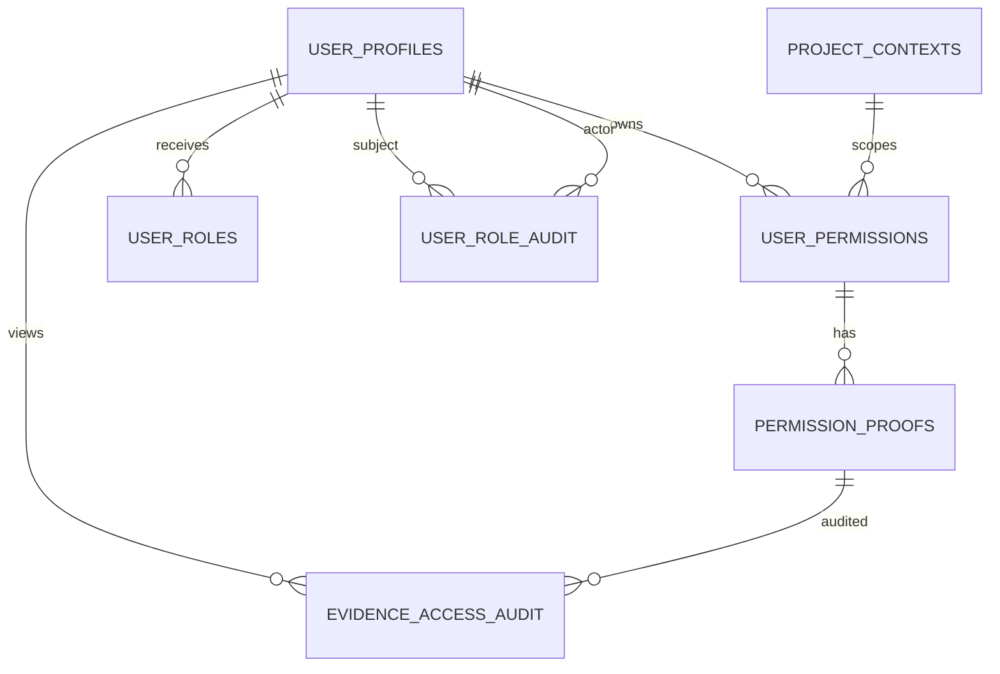

# DPDP RAF Project Report

## Project Summary

DPDP RAF is a private web application for employees to sign in with an E-code, maintain a profile, record already-approved project permissions with evidence, and provide administrators with permission search and role-management workflows. Recording a permission does not grant access; authorization must come from the organization's approval process.

The repository is an npm-workspaces monorepo containing a React single-page application, an Express JSON API, SQL Server persistence, database scripts, and operational documentation.

## Technology Stack

| Area | Technology | Purpose |
|---|---|---|
| Runtime | Node.js 22.22+ and npm 11+ | ES modules and workspace tooling |
| Web client | React 19, React Router 8, Vite 8 | SPA rendering, client routes, and development/build tooling |
| Client data and forms | TanStack React Query 5, React Hook Form 7, Zod 4 | API-backed state, form state, and client validation |
| UI | Tailwind CSS 4 integration, Lucide React | Styling and interface icons |
| API | Express 5 | JSON endpoints, validation, authentication flow, and upload handling |
| Database | Microsoft SQL Server via `mssql` 12 | Profiles, project contexts, permissions, roles, and audits |
| Security and operations | Helmet, CORS, express-rate-limit, cookie-parser, jsonwebtoken, Pino | HTTP headers, origin controls, rate limits, session cookies, signed tokens, and structured stdout logs |
| File upload | Multer 2 | Permission evidence upload and request-size/type handling |
| Tests and lint | Node `node:test`, Supertest, ESLint, Oxlint | API tests and code-quality checks |

## Architecture

The browser runs the Vite-hosted React SPA. Client routes are defined in `apps/client/src/App.jsx`; route components submit requests to the Express API. During development, Vite proxies `/api` requests to the API, which keeps the API bound to loopback even when the client is exposed to a trusted LAN through `start-network.bat` or `npm run dev:network`.

The API validates request data with Zod, verifies session cookies, enforces origin checks for state-changing routes, and delegates SQL operations to `apps/server/src/repositories/profileRepository.js`. The server initializes or extends its SQL Server schema at startup. The database remains authoritative for profiles, permissions, and active administrator roles.

## Main User Flows

1. Sign-in sends the E-code and password to the configured fixed HTTPS employee-authentication service. A successful upstream 2xx response continues the flow; an optional returned E-code must match the submitted identity.
2. Existing profiles receive an application session in an HttpOnly cookie. First-time users receive a short-lived profile-setup cookie, complete their profile, and then receive an application session.
3. Signed-in users record a permission they have already received, attach approval evidence, and must acknowledge the associated risks. The API requires the acknowledgement and records its UTC timestamp; acknowledgement is not authorization.
4. Admin managers can create employee profiles individually or import a bounded `.xlsx` workbook. Existing E-codes and email addresses are never overwritten; import results identify created, duplicate, and invalid rows. Employees still authenticate with the configured organization sign-in service.
5. Administrators can search permission records and review evidence. Active roles are loaded from SQL Server for protected admin operations rather than trusted from a client-side role value or JWT role claim.
6. Admin managers can assign or revoke administrator roles with a reason. Role changes and evidence-view attempts have separate audit records.

## Client Routes

| Route | Purpose |
|---|---|
| `/` | Employee sign-in |
| `/profile/setup` | First-time profile registration |
| `/dashboard` | Signed-in overview and recent permission activity |
| `/profile` | Profile settings |
| `/approvals` | Existing permission records, evidence, and risk acknowledgement |
| `/risk-acceptance` | Permission-risk disclosure page |
| `/admin` | Protected permission search and role administration |
| `/admin` (admin manager) | Employee single-entry and Excel bulk provisioning |

## Database Structure

The application uses the `dbo` schema. The startup schema is defined in `apps/server/src/db/initializeDatabase.js`; `docs/database-bootstrap.sql` is the bootstrap script for a target database. Both schema paths include `risk_accepted_at` on `dbo.user_permissions`. Existing permission rows may have a `NULL` risk-acceptance timestamp because the field was added after earlier records were created.

| Table | Purpose | Important fields |
|---|---|---|
| `dbo.user_profiles` | One employee profile per E-code | `ecode`, `fullname`, `office_email`, `phonenumber`, `created_at`, `updated_at` |
| `dbo.project_contexts` | Reusable project/client/business context | `wbs_code`, `client_name`, `lob_name`, `created_at` |
| `dbo.user_permissions` | Employee permission record and current status | `ecode`, `context_id`, `permission`, `consent_status`, `granted_at`, `risk_accepted_at` |
| `dbo.permission_proofs` | Private evidence metadata linked to a permission | `permission_id`, `file_path`, `original_filename`, `content_type`, `uploaded_at` |
| `dbo.user_roles` | Current and revoked admin-role assignments | `ecode`, `role_name`, assignment and revocation actors/timestamps |
| `dbo.user_role_audit` | Role assignment and revocation history | `ecode`, `role_name`, `action`, `changed_by`, `changed_at`, `reason` |
| `dbo.evidence_access_audit` | Administrator evidence-view attempts | `proof_id`, `actor_ecode`, `accessed_at` |
| `dbo.application_audit_events` | Authentication, logout, profile, and bulk-provisioning events | `request_id`, actor/subject E-code, event, outcome, limited JSON details, UTC timestamp |

### Relationships

Foreign-key details:

- `user_permissions.ecode` references `user_profiles.ecode`.
- `user_permissions.context_id` references `project_contexts.id`.
- `permission_proofs.permission_id` references `user_permissions.id`.
- `user_roles.ecode`, `assigned_by`, and `revoked_by` reference `user_profiles.ecode`.
- `user_role_audit.ecode` and `changed_by` reference `user_profiles.ecode`.
- `evidence_access_audit.proof_id` references `permission_proofs.id`; `actor_ecode` references `user_profiles.ecode`.

Application audit events intentionally have no profile foreign keys so unsuccessful authentication attempts can be recorded without storing the submitted identity. Event details contain reason codes and import counts/row numbers only; passwords, tokens, cookies, profile field values, and raw request data are excluded. Admin role changes and evidence access remain in their dedicated audit tables.

Important uniqueness and checks include unique E-code and office email, a unique WBS/client/LOB context, a unique employee/context/permission mapping, one active instance of a role per employee, and allowed values for permission status and role actions. Permission and evidence writes use a SQL transaction. Permission status represents the latest `GRANTED` or `REVOKED` state; it is not a complete event history.

## Database Inspection

Run `docs/database-inspection.sql` in SQL Server Management Studio or Azure Data Studio after connecting to the application database. It returns database identity, table row estimates, column definitions, indexes and keys, foreign-key relationships, check constraints, and a result set containing rows from each user table. Set `@MaxRowsPerTable` near the top of the script to a positive number to limit each table; leave it `NULL` to return all rows.

The data result sets may contain employee names, E-codes, contact details, role history, and evidence metadata. Use an authorized database account and do not share unprotected query results. Evidence files themselves are stored in the server's private upload directory, not in SQL Server.

## Security and Operations

- Session tokens are signed server-side and stored in HttpOnly cookies; the application token does not carry administrator role claims.
- Pino emits structured JSON to stdout. Request events include a request ID, method, matched route template, response status, and duration; query strings, bodies, credentials, cookies, tokens, and employee identifiers are omitted.
- Login uses a configured HTTPS upstream. The client cannot choose the authentication URL, and credentials are not written to client logs.
- Global API and stricter login rate limits are applied. Proxy trust is disabled unless explicitly configured with trusted addresses/subnets.
- Permission evidence is stored outside static client serving and served only after server-side administrator authorization.
- `start-network.bat` and `npm run dev:network` are development conveniences for trusted LAN testing, not public hosting. The launcher binds Vite to LAN and leaves the API behind the local Vite proxy.
- For production, use HTTPS, a trusted TLS proxy, restrictive database privileges, protected file storage, managed secrets, reviewed retention policies, and database migrations separated from runtime startup.

## Repository Entry Points

| Path | Responsibility |
|---|---|
| `apps/client/src/App.jsx` | SPA routes and session query |
| `apps/client/src/routes/` | Login, profile, dashboard, permissions, risk disclosure, and admin pages |
| `apps/server/src/server.js` | Express app, API routes, middleware, and startup |
| `apps/server/src/db/` | SQL Server pool and schema initialization |
| `apps/server/src/repositories/profileRepository.js` | Parameterized SQL reads and writes |
| `apps/server/test/server.test.js` | API tests with Node's test runner and Supertest |
| `scripts/dev.mjs` | Local and LAN development process launcher |